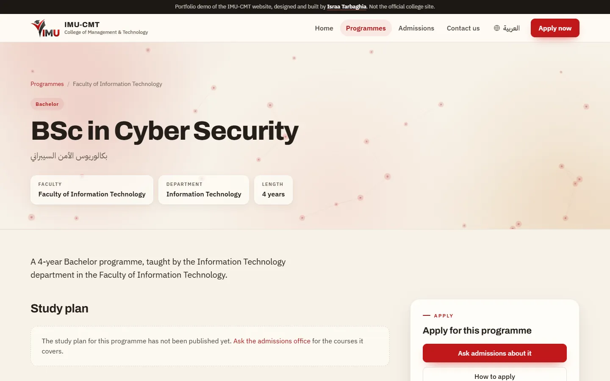
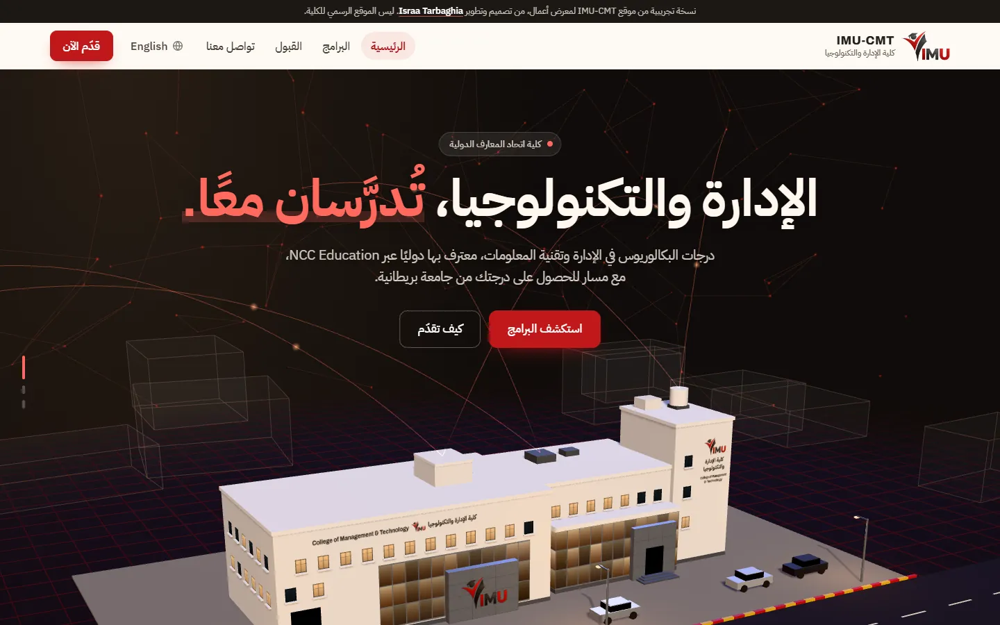

# IMU-CMT College website

A website for IMU College of Management & Technology in Tripoli: its programmes, admissions and contact details, in English and Arabic, opening on a 3D model of the campus.

**Demo:** https://israairtirt.github.io/imu-website/

| | |
|---|---|
| Client | IMU College of Management & Technology, Tripoli |
| Built with | HTML, CSS, JavaScript, three.js |
| Languages | English and Arabic, right to left |

## What I built

- A page for each of the college's eight bachelor's programmes, grouped by faculty, plus admissions steps and a contact page.
- A homepage that opens on a model of the college building, drawn with three.js from photos of the real one. It loads after the page has painted. Without WebGL, without JavaScript, or for visitors who ask for less motion, the page shows a photograph instead.
- English and Arabic throughout, with a right-to-left layout in Arabic.
- Meta descriptions in both languages and Arabic programme titles for search engines.
- Motion that switches off for visitors who prefer reduced motion.

## About this demo

This is a static copy made for the portfolio, not the college's official site, and it asks search engines not to index it.

## About this repository

This repository holds the published build that GitHub Pages serves: minified HTML and CSS, and minified, obfuscated JavaScript (three.js is included as published under its MIT licence). The source code is private.

Designed and built by [Israa Tarbaghia](https://israairtirt.github.io/).
